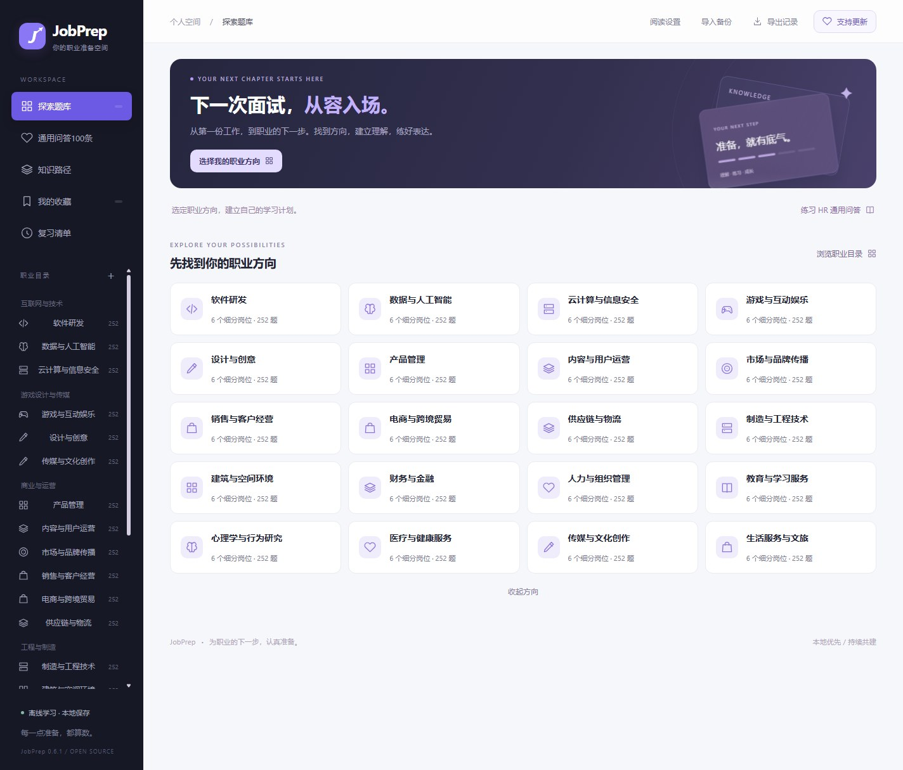
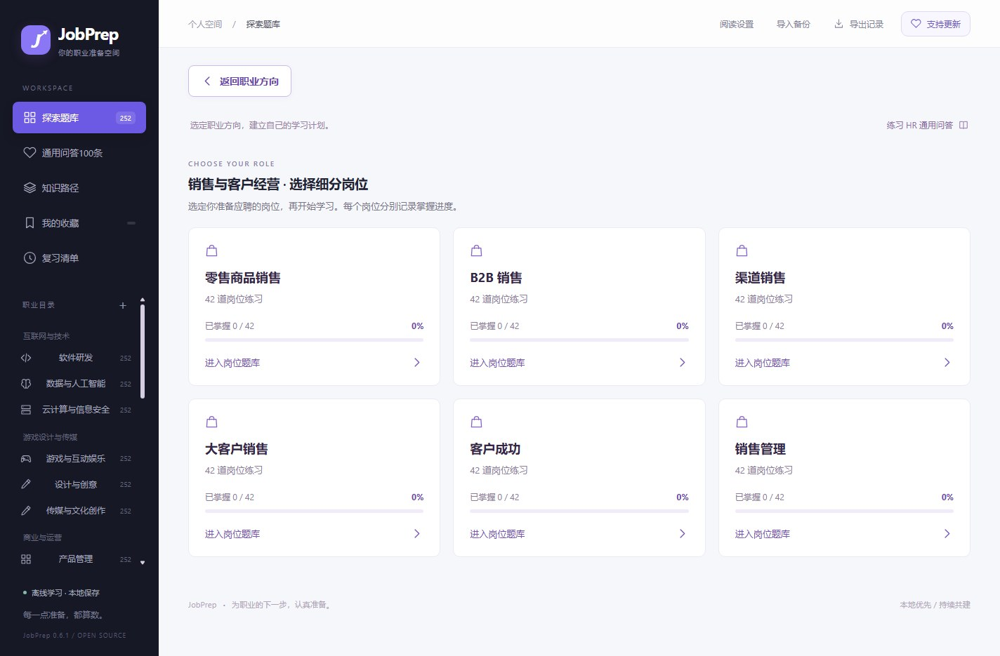
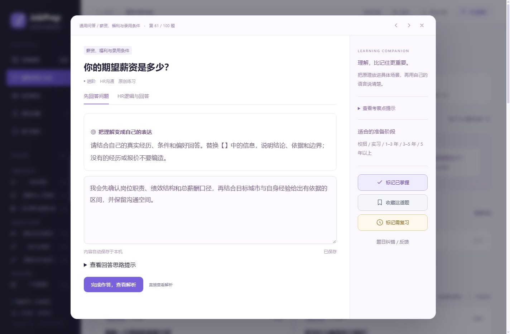
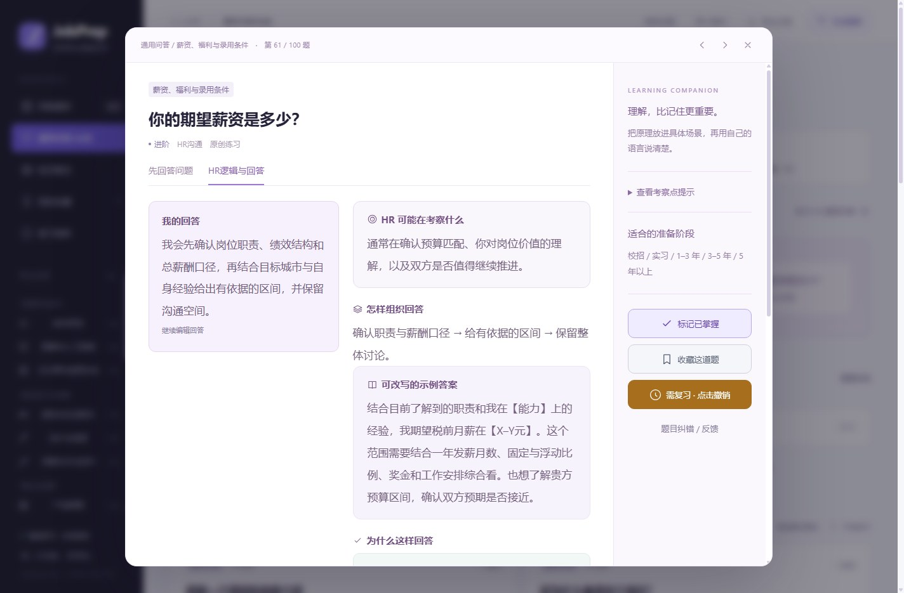

# JobPrep

**面向多行业、多岗位求职者的开源面试准备桌面软件。** 覆盖销售、设计、游戏、教育、心理学、财务、制造、医疗健康等职业方向，离线使用、本地保存，无需账号。

Offline interview preparation for multiple industries and roles. Chinese content, local-first learning.

当前版本 **0.6.1**：20 个职业方向、120 个细分岗位，每岗位 42 道专业练习，另含 100 道通用问答，共 5,140 道。

[](https://github.com/MRYH1013/JobPrep/actions/workflows/ci.yml)

**[下载 Windows 版本](https://github.com/MRYH1013/JobPrep/releases/latest)** · [安装与使用](SUPPORT.md) · [提交反馈](https://github.com/MRYH1013/JobPrep/issues) · [版本记录](CHANGELOG.md)



## 下载

普通使用无需安装 Node.js 或 Python。在 [Releases](https://github.com/MRYH1013/JobPrep/releases/latest) 下载 Windows x64 安装包，或下载 zip 完整解压后运行 `JobPrep.exe`。发行页提供 SHA-256 校验文件。当前安装包未做代码签名；macOS、Linux 和 Windows ARM64 暂未完成发行测试。



## 行业与岗位覆盖

|领域|职业方向|
|---|---|
|商业与服务|销售与客户经营、电商与跨境贸易、供应链与物流、生活服务与文旅|
|设计与内容|设计与创意、传媒与文化创作、市场与品牌传播、游戏与互动娱乐|
|组织与专业服务|人力与组织管理、教育与学习服务、财务与金融、心理学与行为研究、医疗与健康服务|
|产品与运营|产品管理、内容与用户运营|
|工程与技术|制造与工程技术、建筑与空间环境、软件研发、数据与人工智能、云计算与信息安全|

每个方向包含 6 个细分岗位。可先选择自己的岗位，再按求职阶段和难度准备；通用问答适合跨岗位练习表达。

## 使用顺序

1. 先选择销售、设计、教育等职业方向，再选择具体岗位。学习百分比只按该岗位计算。
2. 点击题目或“开始作答”，先独立回答。考察点与思路提示默认折叠。
3. 提交后对照“我的回答”和参考解析，自行勾选回答要点。
4. 根据实际情况标记“需复习”或“已掌握”。提交不会自动计入掌握，已掌握题目排在后面。
5. 下次通过“继续上次学习”返回题目和草稿。职业方向、岗位、回答、收藏、阅读设置均保存在本机。





## 学习功能

- 职业目录：20 个方向、120 个岗位，支持检索、经验阶段、难度和全文筛选。
- 收藏：全部收藏、当前岗位、通用问答三个范围，收藏总数不受当前职业限制。
- 复习：答过但需复习、到期复习、收藏重点、全部未掌握；可切换当前岗位、全部岗位与通用问答。
- 复习时间：需复习默认次日，已掌握默认七天后再练；本机时间变化会影响到期判断。这是简单学习安排，不是经过验证的记忆预测模型。
- 岗位路线：基础、进阶、挑战三个阶段，每阶段列出题量与掌握数，点击进入真实题目子集。
- 离线模拟面试：按当前筛选随机抽题，选择题数与总时长；过程中隐藏解析，提交推进，结束后逐题复盘；不自动评分。
- 阅读设置：紧凑、标准、大字与舒适行距。
- 题目反馈：生成包含题目编号的 Markdown 纠错文件，由用户自行提交到项目 Issues，不自动发送。
- 右上角打赏码：悬停展示、移开隐藏、点击固定、再次点击收起。

软件中已移除职业资料库及资料来源展示。研究归档属于开发维护材料，不计入练习题数量，也不包含在当前桌面运行包中。

## 备份与恢复

点击右上角“导出记录”下载 JSON 文件。通过“导入备份”选择文件，预览后再合并：

- 支持旧版 v3 导出及新版 v4 备份；忽略当前题库不存在的编号并显示数量。
- 合并保留其他题目记录；相同题目的回答、复习时间和自查项以导入内容为准。
- 收藏取并集；导入的掌握或需复习状态优先。建议合并前先导出当前记录。
- 文件上限 20MB；格式或版本错误时拒绝导入。写入失败时不应用导入状态。
- 保存失败会明确显示，当前窗口中的回答仍可导出。备份文件含用户自行填写的回答，应由用户自行保管。

没有账号、云同步、AI 模拟面试或后台上传。卸载前、换电脑前建议导出记录。

## 内容质量与范围

前端与 Java 后端各 42 题，共 **84 道**在 0.6.0 中补充独立场景、展开分析和逐题自查要点，8 道提供代码或 SQL 示例。原有题目 ID 保留，学习记录继续兼容。

其余专业练习主要由岗位专题按原理、实施、异常、验证、取舍和协作任务组织。不同任务可以共享专题，题量不等同于独立知识点数量；不声称是企业真题或经统计的“大厂高频”。现有内容尚未经过领域专家逐题审查，后续应继续增加独立案例与专业审阅。

通用问答按 10 个主题组织，包括 HR 可能的考察逻辑、回答框架、示例、理由、误区与追问；示例需要结合真实经历改写。专业资格、地区要求及安全相关判断需按实际场景核实，健康类内容不用于诊断治疗。

[岗位题量报告](content/COVERAGE.md) · [修订范围](content/EDITORIAL.md) · [版本记录](CHANGELOG.md)

## 运行与构建

需要 Node.js 22.12+、Python 3。

```sh
npm ci
npm run content:build
npm run check
npm run test:core
npm run test:smoke
npm run test:features
npm start
```

```sh
npm run pack  # 可运行目录
npm run dist  # Windows NSIS 安装包
```

首次安装依赖与构建可能需要网络；已打包的学习功能可离线使用。当前本地构建未签名。窗口标题与侧栏标明软件版本。

`scripts/publish-local.ps1` 将最新本地构建同步到原启动位置并更新桌面快捷方式；只在 Electron 运行时版本一致时同步。它不发布到 GitHub。

## 项目结构

- `app.js`：职业选择、题目浏览与基础学习界面。
- `learning-core.js`：备份校验、合并与学习状态规则。
- `learning.js`、`learning.css`：复习、恢复、对照自查、模拟面试及阅读设置。
- `content/expanded/`：120 个岗位的专题任务素材。
- `content/legacy-questions.json`：原有 252 道题快照与稳定 ID。
- `content/refined-frontend.txt`、`content/refined-backend.txt`：84 道场景、展开分析与自查要点。
- `content/refined-code.json`：代码和 SQL 示例。
- `content/general.txt`：100 道通用问答。
- `questions.js`、`general-data.js`：生成产物，不建议手工编辑。
- `desktop/`：Electron 入口及界面回归测试。

## 开源与反馈

代码采用 [MIT](LICENSE)；原创练习内容采用 [CC BY 4.0](LICENSE-CONTENT.md)。第三方材料保留原有权利，见 [第三方说明](THIRD_PARTY_NOTICES.md)。题目纠错请附稳定编号、修改建议及判断依据，见 [CONTRIBUTING.md](CONTRIBUTING.md)。项目提供问题、题目纠错和功能建议模板。

GitHub：[MRYH1013/JobPrep](https://github.com/MRYH1013/JobPrep)。安全问题请参阅 [SECURITY.md](SECURITY.md)，一般使用问题请参阅 [SUPPORT.md](SUPPORT.md)。
